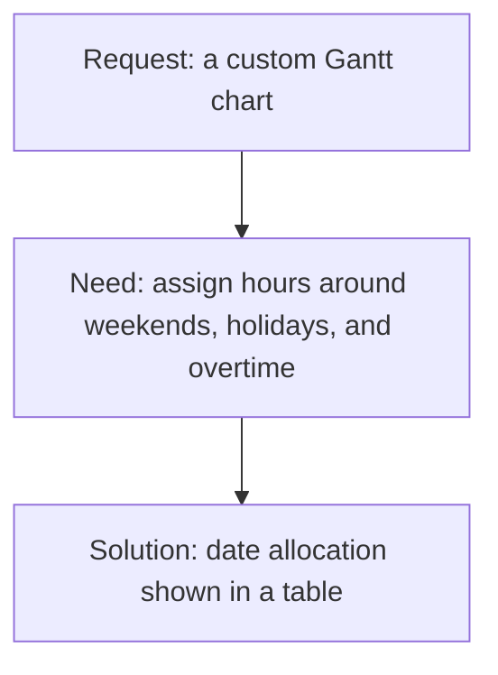

# What a pipeline TD does

At Virgil's studio, colleagues asked for a Gantt chart: a timeline showing when work is scheduled. Their tracking-system vendor had suggested building a custom one in a web framework.

Virgil looked into what they needed to schedule. The goal was to assign people's working hours across weekends, holidays, and overtime. An algorithm that assigns the dates, shown in a plain table, met that need.

Virgil is a **pipeline TD** (technical director), and the author of this course. His example raises a useful question for a programmer considering visual effects (VFX): what changes when you become responsible for helping artists get their work done?

## A request is the beginning of the problem

The Gantt chart request named a possible solution. Understanding the scheduling need gave Virgil a way to judge whether that solution was necessary.

*In this case, understanding the need led to a smaller tool. The example comes from Virgil's own studio experience.*

The same responsibility applies when an artist reports that a shot will not load or a publish fails. The TD needs to understand the work the person is trying to do, investigate the problem, and decide what will help. Writing a feature is one possible result of that investigation.

In Virgil's experience, artists and supervisors may not have the words to describe a technical problem or see how the pipeline works inside. His advice is to take their point of view seriously, even when you think there is a better approach. They know parts of the work that you need to understand.

## Your result is someone else's ability to work

A pipeline TD writes and supports the tools that move work through a studio. If [the pipeline](vfx-pipeline.md) keeps handoffs usable, the TD helps people rely on those handoffs day to day.

That includes scripts and plugins inside artists' applications, such as Maya for 3D, Houdini for effects, and Nuke for compositing. It also includes supporting artists directly: finding why files will not load, why a render failed, or why work cannot be published.

Virgil's first tool for compositing artists was a small server that let them run code inside Nuke directly from their text editor. He had worked in software development; helping those artists gradually became a pipeline job. Their work gave his programming a concrete purpose.

Support also involves other people. A TD may need to turn an artist's complaint into a clear problem for software developers or IT, or explain a technical limit to the **production team**, which plans the studio's schedule and budget.

The **show**, the film or series the studio is working on, has deadlines. Those deadlines affect which improvements can wait and which problems need attention now. At [one pipeline developers' meetup](https://pipedev.org/posts/2023-05-17-what-makes-a-pipeline-person/), participants described a changing balance between development and support. You should expect both responsibilities, rather than a fixed percentage of each.

## Adding code creates another responsibility

"Writing code to fix a problem is easy, because it's fun," Virgil says. The cost continues afterward: upgrades, changes, bug fixes, and the time someone needs to understand the tool.

For him, a good day can mean helping a colleague think through a problem and finding a solution that needs no new feature. That judgment is part of maintaining a system people depend on.

When he built his studio's pipeline, he began by sitting down with supervisors and mapping how work should flow. Looking back, one thing he would change is releasing tools sooner and getting feedback, rather than trying to perfect every detail first.

Testing and documentation serve the same responsibility. A tool has to work in the artist's production context, and someone has to explain it well enough for others to use and support it. Feedback reveals whether it solves the need you understood at the start.

## The work changes with the studio

In a small studio, one pipeline TD may design, build, install, document, and support most of the system. Virgil works this way. In a large studio, pipeline TDs, software developers, supervisors, and other technology staff may share those responsibilities.

This matters when you read a job description. The title alone does not tell you how much direct support, tool development, or responsibility for the overall system the position includes.

| Role | Main focus |
|---|---|
| **Pipeline TD** | Tools and handoffs across departments, with direct artist support |
| **Department TD**, such as an effects or lighting TD | Technical problems within one department, often including work seen on screen |
| **Software developer (R&D)** | Core systems and new technology, often on longer projects with less direct artist support |
| **IT** | Accounts, networks, storage, and machines |

These are broad distinctions, not universal job boundaries. Studios also use *pipeline TD* and *pipeline developer* differently. Ask who uses the tools, who supports those users, and what part of the system the role owns.

## Would this work suit you?

The programming is substantial, but it comes with investigating another person's problem, communicating across roles, and maintaining tools through changes. Those responsibilities are worth considering alongside the technologies in a posting.

Artists who move into TD work bring knowledge of what artists need. Programmers bring software experience and have to learn how a studio makes its shots. Either route involves learning the other side of the work.

The postings and career profiles below mention Python, Linux, and tool development inside artist applications. They also mention interface libraries such as Qt and PySide, Git, testing, and production systems. Requirements vary by studio and seniority; use a particular posting to find out what that role expects. The linked ILM posting is one example, not a universal checklist.

If you enjoy understanding someone's work, building tools around it, and staying involved when those tools need support, these are reasons to explore the role further. Virgil describes what he wishes he had understood earlier:

> "Pipeline is more about the people using the pipeline than the code itself. You are connecting people, not abstract interfaces of DCCs and databases."

Here, **DCC** means a digital content creation application, such as Maya or Nuke. The applications and databases are part of the system; the people using it give the work its purpose.

The [course overview](../course-overview.md) describes one path for programmers who want to develop those skills.

## Further reading

- ScreenSkills, [Pipeline technical director (TD)](https://www.screenskills.com/job-profiles/roles/pipeline-technical-director-td): the UK screen industry's career profile, with links to related TD roles.
- Industrial Light & Magic, [Pipeline Technical Director, Level I](https://www.entertainmentcareers.net/industrial-light-and-magic/pipeline-technical-director-level-i-expression-of-interest/job/415259) (2023): one entry-level posting from a large studio; compare its requirements with the role you are considering.
- pipedev.org, [What Makes a Pipeline Person?](https://pipedev.org/posts/2023-05-17-what-makes-a-pipeline-person/) (2023): practitioner discussion of development, support, and career paths.
- Lidia Martinez, [All about Technical Directors](https://blog.lidia-martinez.com/all-about-technical-directors-part-1): a former TD on the different jobs that share the title.
- Foundry, [What is a Technical Director? VFX roles explained](https://www.foundry.com/insights/technical-director-vfx-roles-explained) (2025): a pipeline TD describes their route and their work.
- The Rookies, [Working as a Pipeline TD at DNEG](https://www.therookies.co/blog/careers/marieke) (2020): an account from a large studio to compare with Virgil's experience.
