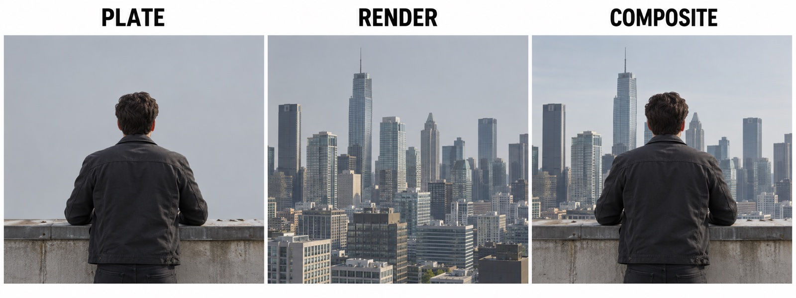
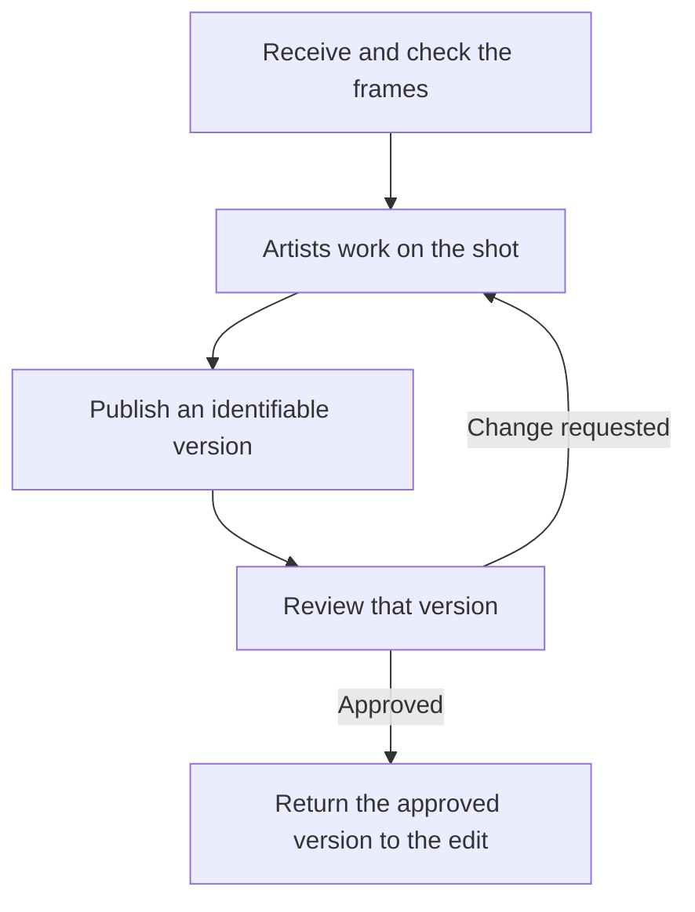

# What a VFX pipeline is

A 3D artist can build a skyline. A compositor can combine it with filmed footage. Their applications already do the difficult work of making images. Why does a visual effects (VFX) studio need a pipeline as well?

Because the next person needs to know which files to use, what they contain, and whether they are ready. Those questions remain even when the image looks right. They become harder when several people work on a shot and the work keeps changing.

The **pipeline** is the system of shared rules, tools, and services that makes those handoffs work. For a programmer, understanding the handoffs explains what the code is there to protect.

## The next person needs more than an image

Consider `SH010`: an actor stands on a rooftop, and the director wants a city skyline behind them. The skyline was not there during filming. This is a fictional example, not an account of a real production.

*AI-generated illustration. Left: the filmed image, or plate. Center: the rendered skyline. Right: the composite combines both.*

A **shot** is a continuous piece of film between two cuts. The filmed frames are its **plate**. A 3D artist builds the skyline and **renders** it: the computer draws it as images. A **compositor** combines that render with the plate so that they look like one camera filmed everything.

The image shows what the artists contribute. To do that work, the compositor also needs the correct plate frames and an identifiable version of the skyline. Someone has to agree on how those files will arrive, where they belong, and how another person will find them.

## Receiving work: know what arrived

The **edit** is the film as it is currently assembled. The film's editor chooses the frames that `SH010` uses. The **VFX editor** manages the VFX shots in that edit and sends a list of the required frames to the lab that holds the camera footage.

The lab sends a **delivery**: a folder of image files, one per frame, and a document describing them. That document gives the studio something to check against. Did every requested frame arrive? Did anything extra come in?

For a programmer, this is input validation at a system boundary. For the artist, it determines whether the material they need is available before they start. A delivery checker turns the agreed description into a check; it does not decide which frames the film should use.

## Sharing work: make a version others can use

The studio records `SH010` in a **production tracking system**, which keeps track of shots, the people working on them, and their status. Each job on the shot is a **task**, such as building the skyline or compositing it with the plate.

When the compositor has work ready for others, a **publish tool** checks it, saves it as version `v001`, and records that version in the tracking system. The next person can then identify what was shared.

This is where naming rules, folders, and versions become useful. A name such as `SH010_comp_v002` identifies the shot, task, and version. An agreed folder structure lets a tool build the path. Keeping earlier versions lets someone return to them and say exactly which one they used.

Publishing resembles releasing a package to a registry: other people need an identifiable result they can use. In a studio, that result also belongs to a shot and a task, and it may depend on particular versions of other artists' work.

These agreements let a launcher open the right files and a publish tool record them consistently. Without an agreed name or location, each tool would have to guess or ask the artist.

## Changing work: keep the handoff clear

A published version can pass its file checks and still need an artistic change. The **VFX supervisor**, who leads the visual effects on the film, reviews `v001` and gives a **note**: "The city is too bright."

The compositor makes the change and publishes `v002`. Keeping both versions makes the review identifiable: the note concerns `v001`, and the revision is `v002`. When a version is approved, it goes back to the VFX editor and replaces the original shot in the edit.

*The handoff repeats when review changes the work. Each published version must remain identifiable throughout the loop.*

The route resembles a build graph, but people judge its output and can send it back. The inputs can change too: a new edit may shorten a shot the compositor has already finished. A pipeline has to support those changes while keeping clear which files and versions people are using.

## The pipeline begins with agreements

Names, folders, publishing, and tracking are often described as separate pipeline features. In this example, they answer the same practical question at different moments: what can the next person use?

[Alexander Richter](https://www.alexanderrichtertd.com/post/visual-effects-pipelines-td-meetup) describes naming rules, folder structures, and software choices as decisions that scripts then automate. The studio needs to agree on those decisions before its tools can apply them consistently.

That is also why studios use *pipeline* in two ways: the route work takes through people and departments, and the code that helps it travel that route. The code depends on understanding the work.

A small studio may manage these agreements with shared folders and a few scripts. A large studio may use dedicated teams, databases, and services. The implementation changes; the next person still needs to find usable work and know which version it is.

[What a pipeline TD does](pipeline-td.md) explains the job of building and supporting that system. To practice building parts of it, see the [course overview](../course-overview.md).

## Further reading

- Alexander Richter, [Visual Effects Pipelines – TD Meetup 03](https://www.alexanderrichtertd.com/post/visual-effects-pipelines-td-meetup) (2024): a practitioner's layered view of a pipeline, and why rules come before scripts.
- Renee Dunlop (ed.), [*Production Pipeline Fundamentals for Film and Games*](https://api.pageplace.de/preview/DT0400.9781317936237_A23908179/preview-9781317936237_A23908179.pdf) (Focal Press, 2014, preview): broader production-pipeline background. It predates USD.
- Pipeline Developer Forum, [Notes from Global CG Pipelines BoF (SIGGRAPH 2024)](https://medium.com/vancouver-pipeline-developer-forum/notes-from-global-cg-pipelines-bof-siggraph-2024-27b0a9ca94f5) (2024): what pipeline developers from many studios said about their work.
- Autodesk, [Flow Production Tracking publisher documentation](https://developers.shotgridsoftware.com/tk-multi-publish2/index.html): how one commercial publishing system implements the handoff.
- Foundry, [How USD is set to change the face of VFX](https://www.foundry.com/insights/film-tv/usd-explainer-guide) (2019): a separate introduction to sharing 3D scene data with Universal Scene Description (USD).
- [VFX Reference Platform](https://vfxplatform.com/): shared library-version targets for the applications and tools used in VFX.
