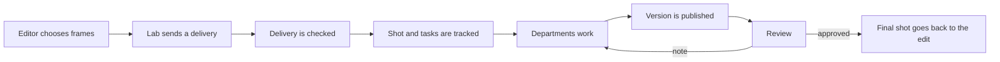

# What a VFX pipeline is

This page is for programmers who are new to visual effects (VFX). It explains what people in a studio mean by "pipeline", so that you can picture how work moves through a studio and see where pipeline code fits. You don't need it to start a module, but it makes the course's examples easier to follow.

The visual effects in a film are made by many people in different departments, often in several countries at once, and each department uses different software. The **pipeline** is the system that moves their work from one department to the next and gives each person the right files.

## One shot, from start to finish

A film is cut into **shots**: one shot is a continuous piece of film between two cuts. Here is an example of one shot's route through a studio. It is an illustration of a typical route, not a real production.

The shot is `SH010`. An actor stands on a rooftop. The director wants a city skyline behind the actor, but there was no skyline on the day of filming.

1. **The editor chooses the frames.** The **edit** is the film as it is currently assembled, shot by shot. The film's editor decides which frames of the filmed clip the shot uses in the edit. A second person, the **VFX editor**, manages the VFX shots inside the edit: they write a list of the frames each shot needs and sends it to the lab that holds the camera footage.
2. **The frames arrive.** The lab sends a **delivery**: a folder of image files, one file per frame, and a document that describes them. Before anyone works on the shot, someone checks that every frame arrived and nothing extra came in. The course's first module builds a tool for this check.
3. **The studio creates the work.** The shot is entered in the **production tracking system**, a database of every shot, who works on it, and its status. Each job on the shot is a **task**: for example, building the city in 3D, and combining the city with the filmed frames.
4. **Departments do their part.** A 3D artist builds the skyline and renders it, which means the computer draws it as images. A **compositor** combines those images with the filmed frames, the **plate**, so that they look like one camera filmed everything.
5. **Work is published.** When the compositor's first attempt is ready, a publish tool checks it, saves it as version `v001`, and records that version in the tracking system, so the next person can find it.
6. **Review sends it back.** At a review session, the **VFX supervisor**, who leads the visual effects on the film, watches `v001` and gives a **note**: "The city is too bright." The compositor makes the change and publishes `v002`. A shot can go around this loop many times.
7. **The shot is final.** When the VFX supervisor approves a version, it goes back to the VFX editor and replaces the original shot in the film.

Every arrow in that diagram is a handoff between people, and every handoff carries files. The pipeline is how each person finds the right files and knows they can trust them.

## Two meanings of one word

People in VFX use "pipeline" in two ways, often in the same sentence:

- **The route of the work.** The sequence of departments and steps that a shot passes through, like the seven steps above.
- **The code that runs the route.** The tools and services that move files and information from one step to the next. Pipeline TDs (technical directors) write this code.

The course teaches the second meaning, but you can't build it without understanding the first.

## What every handoff needs

For the handoffs to work, the studio needs a few things that every person and every tool agree on:

- **Names.** Every shot, task, and version has a name that follows a studio rule, such as `SH010_comp_v002`. Tools find files by name, so a file with a wrong name is a file no tool can find.
- **Folders.** The studio decides where every kind of file goes. A tool can then build the path from the shot and the task, instead of asking the artist.
- **Versions.** Artists save each change as a new version and never overwrite the old one. Anyone can go back to an earlier version, and the next department can say exactly which version it used.
- **Publishing.** A publish tool checks work that is ready for others, saves it as a version, and records it in the tracking system.
- **Tracking.** The production tracking system records which shots exist, who works on each task, and the status of each one. Common examples are Autodesk's Flow Production Tracking (formerly ShotGrid), ftrack, and Kitsu.

## Rules first, scripts second

The rules come before the code. One practitioner puts it this way: a naming rule, a folder structure, and a choice of software come first, and scripts only automate those decisions. In other words, a studio with a clear naming rule and no scripts already has the start of a pipeline. A studio with many scripts and no rule has a mess.

## If you know software

Many pipeline ideas look like things you already know from software. The comparisons help, but each one has a limit.

| Pipeline idea | Similar to | Where the comparison stops |
|---|---|---|
| Publishing a version | Releasing a package to a registry | Artists publish many times a day, and each publish also records the shot, the task, the artist, and which versions of other work it used |
| Production tracking | An issue tracker | It tracks shots and artists' tasks, not bugs, and the production team plans the studio's schedule with it |
| Checking a delivery | Input validation at a system boundary | The input is thousands of image files, and the user is a person who decides what to do next |
| The route of a shot | A build graph | People review the output, and a review can send work back to an earlier step |

## It isn't an assembly line

The route looks like a straight line, but real work loops back. A review note sends a shot back to an artist. A change in the edit can shorten a shot that the compositor has already finished. A pipeline works more like a network of small routes joined by review loops than like one conveyor belt.

Newer tools also reduce the time departments spend waiting for each other. **USD** (Universal Scene Description) is a file format, first developed by Pixar, that stores a 3D scene as stacked layers. With it, several departments can work on the same shot at the same time, each in its own layer, instead of waiting for the department before them.

## Why VFX Python is often older

Studios and software makers agree every year on shared versions of Python, Qt, and other libraries. This agreement is called the **VFX Reference Platform**. It lets studio tools run inside the commercial applications that artists use. Because of it, VFX studios often use an older Python than the newest release.

## Small studio, large studio

There is no single definition of a pipeline, partly because every studio builds its own.

A small studio might start with shared folders, a naming rule, and a few scripts that one person maintains. As it grows, the pipeline grows with it. For example, one small studio's pipeline has these parts:

- an **ingest** tool, which checks incoming deliveries and copies them into the studio's folders (step 2 of the example);
- a **launcher**, which opens the right application for the artist's task (step 4);
- **publish tools** inside each artist application (step 5);
- a link to the production tracking system;
- an **installer**, which sets up the pipeline on every machine.

A large studio has dedicated pipeline teams, databases, and services. Some large studios support artists 24 hours a day across several sites. [What a pipeline TD does](pipeline-td.md) describes how the job changes with the size of the studio.

## Where the course fits

The course builds pieces of the code that runs this route. Its first module builds a tool for step 2 of the example: it checks a delivery of image files before anyone works on it. Later modules move along the route, into the applications that artists use and the systems that connect them. The [course overview](../course-overview.md) lists what each module builds, and [What a pipeline TD does](pipeline-td.md) describes the job the course prepares you for.

## Further reading

- Alexander Richter, [Visual Effects Pipelines – TD Meetup 03](https://www.alexanderrichtertd.com/post/visual-effects-pipelines-td-meetup) (2024): a practitioner's layered view of a pipeline, and why rules come before scripts.
- Renee Dunlop (ed.), [*Production Pipeline Fundamentals for Film and Games*](https://api.pageplace.de/preview/DT0400.9781317936237_A23908179/preview-9781317936237_A23908179.pdf) (Focal Press, 2014, preview): the standard book on production pipelines. It predates USD.
- Pipeline Developer Forum, [Notes from Global CG Pipelines BoF (SIGGRAPH 2024)](https://medium.com/vancouver-pipeline-developer-forum/notes-from-global-cg-pipelines-bof-siggraph-2024-27b0a9ca94f5) (2024): what pipeline developers from many studios said about their work.
- Autodesk, [Flow Production Tracking publisher documentation](https://developers.shotgridsoftware.com/tk-multi-publish2/index.html): how one commercial publishing system works.
- Foundry, [How USD is set to change the face of VFX](https://www.foundry.com/insights/film-tv/usd-explainer-guide) (2019): an introduction to USD from a software vendor.
- [VFX Reference Platform](https://vfxplatform.com/): this year's shared library versions.
